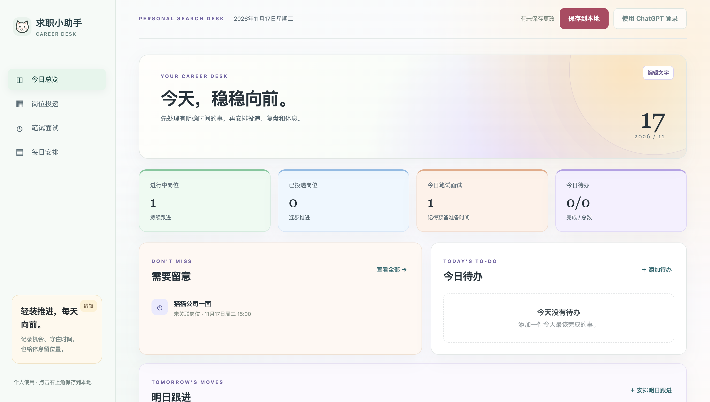

<div align="center">

# 🐱 求职喵务局 · Career Meow Desk

**在一张网页里整理岗位投递、笔试面试与每日安排。**


</div>

---

## 📖 关于本项目

求职喵务局是一个无需安装依赖或构建的中文静态网页，适合在电脑和手机浏览器中记录求职机会、重要日期和每天的时间安排。代码可以放在 GitHub Pages；当前版本没有云端账号或跨设备同步。

- ✅ 记录岗位、笔试面试、待办和日程，并在今日总览查看临近事项。
- ✅ 用本地规则拆分一句话待办，自动生成可调整的日程草案。
- ✅ 用户主动点击“保存到本地”后，才把填写内容写入当前浏览器。
- ⚙️ 可选择在各自电脑运行本地 ChatGPT 服务，或连接自己部署的兼容模型接口。

> **当前状态：**静态网页与本地规则可用；GitHub Pages 公网部署、真实 ChatGPT 账号授权和真实模型生成尚未完成验证。公开网页上的 ChatGPT 登录目前不可用。

---

## 🖼️ 界面预览

### 今日总览



截图使用虚构的“猫猫公司”面试记录，拍摄时页面仍显示旧名称“求职小助手”。每日安排的公开预览图仍待补充；请勿把真实公司、面试链接或个人记录放进截图。

---

## 📋 目录

- [功能概览](#-功能概览)
- [使用方法](#-使用方法)
- [可自由调整的部分](#-可自由调整的部分)
- [核心原则与数据边界](#-核心原则与数据边界)
- [项目结构](#-项目结构)
- [发布到 GitHub Pages](#-发布到-github-pages)
- [许可证与待补充内容](#-许可证与待补充内容)

---

## ✨ 功能概览

| 功能 | 当前能做什么 |
| --- | --- |
| 今日总览 | 查看今日与逾期待办、临近截止、重要事件和明日跟进；同步日程的完成状态与原时间块一致。 |
| 岗位投递 | 记录公司、岗位、城市、进度、截止时间、转正信息和下一步，并搜索和筛选。 |
| 笔试面试 | 可先记录事件，日期和具体时间稍后补充；填写日期后临近时会出现在“需要留意”，填写开始时间后可按设定提前提醒。也支持记录链接、地点、准备与复盘内容，并导入 TXT/MD 格式的 JD 文本。页面内提醒仅在网页打开时显示。 |
| 每日安排 | 按日或周查看时间块；可拖动或点选时间调整。普通安排冲突时可向后顺延，固定笔试面试不会移动；支持当日 24:00 结束。 |
| 一句话排程 | 本地规则拆分会把草案自动放入当天时间表；可逐项编辑、拖动、确认后再手动保存。当天放不下的事项需要自行处理。 |
| AI 草案 | 可连接自己部署的兼容模型服务；在每人本机运行 `local-app/` 时，可尝试授权 ChatGPT 订阅。两种方式均需各自配置或授权，真实模型联调尚未完成。 |

顶部文案、侧栏提示和自定义日程分类也可以编辑。当前没有微信小程序、云端同步、数据导出或跨设备账号。

---

## 🚀 使用方法

### 方式一：使用静态网页

在项目目录运行：

```bash
python3 -m http.server 4173
```

浏览器打开 `http://localhost:4173`。也可以把静态文件发布到 GitHub Pages 后访问公开网址。直接用 `file://` 打开 `index.html` 时，浏览器本地存储行为可能不同，不适合验证保存功能；参见 [MDN localStorage 说明](https://developer.mozilla.org/en-US/docs/Web/API/Window/localStorage)。

使用时先填写岗位、事件或日程，再点击右上角 **“保存到本地”**。刷新或关闭前未保存的修改会丢失。

### 方式二：在自己的电脑连接 ChatGPT

安装 Node.js 20 或更新版本，在项目目录运行 `node local-app/server.mjs`，再用 `http://127.0.0.1:4173` 打开网页。该服务只监听本机，并把登录凭证保存在仓库外。操作和限制见 [本地 ChatGPT 版说明](local-app/README.md)。真实授权能否成功取决于账号、地区和网络环境；现有测试并不证明已联通。

### 方式三：连接自己的兼容模型服务

网页中的“其他 AI 服务”需要填写自己部署的服务地址和访问码。`server/` 提供独立的接口模板，模型密钥只通过服务端环境变量配置；详见 [服务端运行说明](server/README.md)。公开网页需要可访问的 HTTPS 服务，GitHub Pages 本身不会运行这个服务。

---

## 🎛️ 可自由调整的部分

| 部分 | 调整方式 |
| --- | --- |
| 顶部与侧栏文字 | 在网页里点击“编辑”，完成后点击“保存到本地”。 |
| 每日安排 | 修改任务名称、时长、分类和同步今日待办选项；拖动或点选时间段。 |
| 自定义分类 | 在“安排时间”弹窗中添加或删除；已使用的分类删除后会归入“其他”。 |
| AI 服务 | 每位使用者填写自己的服务地址和访问码；访问码不写入浏览器存储。 |

---

## 💡 核心原则与数据边界

1. **使用者决定何时保存。**岗位、事件、待办、时间块、文案和草案只在点击“保存到本地”后写入当前浏览器的 `localStorage`。清除浏览器数据会丢失记录，手机与电脑不会自动同步。
2. **求职记录不因发布网页而进入 GitHub 仓库。**但同一浏览器资料的其他使用者可能看到已保存记录；`localStorage` 按网址来源隔离，不按仓库路径隔离。同一 `用户名.github.io` 下的其他项目页可能共享存储访问范围，处理真实资料时建议使用专用域名或单独浏览器资料。
3. **AI 请求由使用者主动发起。**本地拆分不调用模型；使用 ChatGPT 或其他 AI 服务生成草案时，输入文字、日期和当天已记录的固定笔面事件会发送给相应服务。生成结果需人工核对。
4. **网页不保存模型密钥。**兼容模型密钥只放在使用者自己的服务端环境变量；网页中的访问码仅在当前页面使用。公开 GitHub Pages 页面不能让访客直接用自己的 ChatGPT 账号登录，相关网站接入需要 OpenAI 批准的 OAuth 客户端与独立后端。[公开网站登录说明](https://developers.openai.com/siwc/website)

---

## 📁 项目结构

```text
Career-meow-desk/
├── index.html             # 网页入口
├── style.css              # 页面样式
├── app.js                 # 页面交互与浏览器本地存储
├── plan-text.js           # 本地规则拆分
├── favicon.svg            # 网站图标
├── .nojekyll              # GitHub Pages 直接发布静态文件
├── local-app/             # 可选：每人在本机运行的 ChatGPT 服务与说明
├── server/                # 可选：自行部署的兼容模型接口与说明
└── plan-text.test.cjs     # 本地规则测试
```

`docs/` 和 `AGENTS.md` 是本机需求与进度资料，已被 `.gitignore` 排除，不属于公开发布内容。

---

## 🌐 发布到 GitHub Pages

1. 使用已创建的 [Career-meow-desk 仓库](https://github.com/Kira-ui-0725/Career-meow-desk)。最少提交 `index.html`、`style.css`、`app.js`、`plan-text.js`；建议再加 `favicon.svg`、`.nojekyll`、`assets/screenshots/` 和经过核对的 README。若希望别人下载完整本地版，再添加 `local-app/`、`server/` 与测试文件。
2. 不要提交 `docs/`、`AGENTS.md`、`.env*`、`.DS_Store`、备份、个人求职数据或本机登录凭证。即使 `.gitignore` 排除了文件，手动上传或已有提交历史仍需另行检查。
3. 推送到 `main` 后，在仓库 **Settings → Pages → Deploy from a branch** 中选择 `main` 和 `/ (root)`。部署后用实际网址检查电脑与手机页面。[GitHub Pages 官方说明](https://docs.github.com/en/pages/getting-started-with-github-pages/creating-a-github-pages-site)

公开仓库中的源码和说明任何人都能阅读；GitHub Pages 只发布静态网页，不运行 `local-app/` 或 `server/`。如果只发布最少的静态文件，请从公开 README 中删去指向未发布目录的链接。

---

## 📄 许可证与待补充内容

目前按建仓时的选择**不添加许可证**，因此这里没有沿用参考项目的使用限制。如希望明确允许他人复用代码，可以之后再选许可证。其他待补充内容：

- GitHub Pages 部署并验证后，在 README 顶部加入在线体验地址。
- 补充不含真实求职信息的“每日安排”截图或演示 GIF。
- 若决定开放代码复用，新增 `LICENSE` 文件后再添加许可证徽章。
- 完成一次公开网址上的桌面与手机操作检查；若提供 AI 功能，再单独验证真实授权或模型请求。
